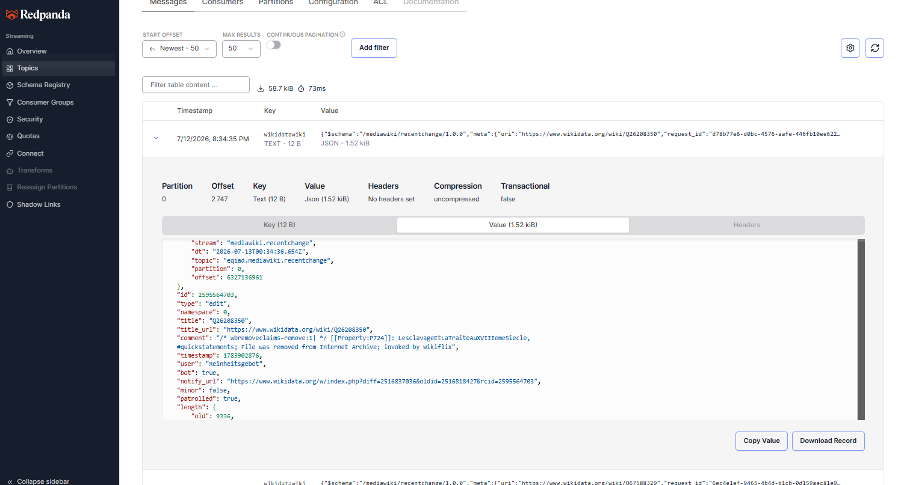

# Wikipedia Streams

A Kafka Streams application in Kotlin that reads the public Wikimedia recent-changes feed, aggregates article edits in windowed state stores, and serves the results from a Ktor REST API. The producer, the stream processor and the API run in one JVM process against a local Redpanda broker.

API reference (Swagger UI, generated from `docs/openapi.yaml`): https://calemccammon.github.io/data-engineer-wiki-streams/

The hosted page is documentation only. The API itself runs locally.

## Running it

Prerequisites: Docker with Compose, and JDK 21 or newer. Gradle does not need to be installed because the wrapper is in the repository.

```bash
git clone https://github.com/calemccammon/data-engineer-wiki-streams.git
cd data-engineer-wiki-streams

# Start Redpanda and Redpanda Console
docker compose up -d

# The wrapper script is committed without the executable bit
chmod +x gradlew

# Build and run the producer, the stream processor and the API
./gradlew run
```

On startup the process starts Kafka Streams, waits up to 30 seconds for it to reach `RUNNING` or `REBALANCING`, then starts the Wikimedia producer and the HTTP server on port 8090. Until the state stores are queryable, the data endpoints return `503` with a JSON error body.

Redpanda Console is available at http://localhost:8080 for inspecting the topics.



### Configuration

The defaults work with the provided `docker-compose.yml`. Each setting is read from an environment variable. `.env.example` lists them, but the application does not load a `.env` file, so the variables have to be exported in the shell that runs Gradle.

| Variable | Default | Purpose |
|---|---|---|
| `KAFKA_BOOTSTRAP_SERVERS` | `localhost:19092` | Broker address |
| `KAFKA_TOPIC_RAW_EDITS` | `wiki.raw-edits` | Input topic |
| `KAFKA_STREAMS_APP_ID` | `wiki-streams-processor` | Kafka Streams application id |
| `STATE_DIR` | `<java.io.tmpdir>/kafka-streams/wiki-streams` | Local state store directory |
| `WIKIMEDIA_SSE_URL` | `https://stream.wikimedia.org/v2/stream/recentchange` | Source feed |
| `API_PORT` | `8090` | HTTP port |

## How it works

```
Wikimedia SSE stream (stream.wikimedia.org/v2/stream/recentchange)
        │
        ▼
  WikiProducer.kt (Ktor CIO client in a coroutine)
  Keeps: type "edit" or "new", namespace 0 (articles)
  Key: wiki name (e.g. "enwiki"), value: the raw event JSON
        │
        ▼
  Kafka topic: wiki.raw-edits  (Redpanda in Docker)
        │
        ▼
  WikiTopology.kt (Kafka Streams)
  ┌─────────────────────────────────────────────────────────────────┐
  │  KStream<wiki, WikiEdit>  (parsed, same filter applied again)   │
  │       │                                                         │
  │       ├── groupByKey → tumbling window (1 min)                  │
  │       │     └─► count per wiki per minute                       │
  │       │         State store: "edit-counts-store"                │
  │       │         Also written to topic "wiki.edit-stats"         │
  │       │                                                         │
  │       ├── selectKey(wiki|title) → hopping window (5 min, 1 min) │
  │       │     └─► count per page                                  │
  │       │         State store: "hot-pages-store"                  │
  │       │                                                         │
  │       └── groupByKey → aggregate(BotRatioState)                 │
  │             └─► running bot and total edit counts per wiki      │
  │                 State store: "bot-ratio-store"                  │
  └─────────────────────────────────────────────────────────────────┘
        │
        ▼
  Ktor REST API (port 8090), reading the state stores in-process
```

### Ingestion

`WikiProducer` opens one long-lived HTTP GET to the Wikimedia feed and reads it line by line. It collects `data: ` lines until a blank line ends the event, parses the JSON into `WikiEdit`, and forwards the original JSON string to Kafka if the event is an article-space edit or page creation. Events that fail to parse are counted as skipped. The Kafka producer is idempotent with `acks=all`. The producer does not use an SSE client library. If the connection fails, `Main.kt` waits 5 seconds and starts a new producer. If the server closes the stream normally, it reconnects immediately.

### Stream processing

The topology parses each record, drops anything that does not parse, and applies the same type and namespace filter as the producer. It then feeds three aggregations.

| Store | Type | Key | Window | Value |
|---|---|---|---|---|
| `edit-counts-store` | window store | wiki | 1-minute tumbling, no grace period | edit count |
| `hot-pages-store` | window store | `wiki\|title` | 5-minute hopping, advancing by 1 minute, 30-second grace period | edit count |
| `bot-ratio-store` | key-value store | wiki | none (cumulative) | `BotRatioState` (total and bot edit counts) |

With the hopping window, each edit is counted in five overlapping windows. An edit at 10:00:45 falls in `[09:56, 10:01)`, `[09:57, 10:02)`, and so on up to `[10:00, 10:05)`.

The stores use the Kafka Streams default, which is RocksDB on local disk with a changelog topic in Kafka. The per-minute counts are also written to the topic `wiki.edit-stats`, keyed by wiki with the count as a string.

Kafka Streams runs with `processing.guarantee=exactly_once_v2` and a 1-second commit interval. If a stream thread dies with an uncaught exception, the handler replaces the thread.

### API

All endpoints are under `/api` and return JSON. The data endpoints read the local state stores through the Kafka Streams interactive query API (`KafkaStreams.store(...)`).

| Endpoint | Returns |
|---|---|
| `GET /api/health` | `status` (`ok` while Kafka Streams is running or rebalancing, otherwise `degraded`) and the raw `streamsState` |
| `GET /api/stats` | One row per wiki per 1-minute window for the windows that started in the last 2 minutes, sorted by `editCount` descending |
| `GET /api/stats/{wiki}` | The 1-minute windows of one wiki that started in the last 5 minutes |
| `GET /api/hot-pages?limit=N` | The most-edited pages, sorted by `editCount` descending. `limit` defaults to 20 |
| `GET /api/bot-ratio` | Cumulative `totalEdits`, `botEdits`, `humanEdits` and `botRatioPct` per wiki, sorted by `totalEdits` descending |

`/api/hot-pages` reads every hopping window that started in the last 5 minutes and reports, for each page, the window with the highest count. Both `/api/stats` endpoints include the window that is still open, so its count is partial.

```bash
curl http://localhost:8090/api/health
curl http://localhost:8090/api/stats
curl http://localhost:8090/api/stats/enwiki
curl "http://localhost:8090/api/hot-pages?limit=5"
curl http://localhost:8090/api/bot-ratio
```

The shape of a `/api/hot-pages` response, with illustrative values:

```json
[
  {
    "wiki": "enwiki",
    "title": "2024 United States elections",
    "editCount": 12,
    "windowStartIso": "2024-01-15T10:00:00Z",
    "windowEndIso": "2024-01-15T10:05:00Z"
  }
]
```

### Versions

| Component | Version |
|---|---|
| Kotlin | 2.0.21, JVM target 21 |
| Gradle (wrapper) | 8.10 |
| Kafka Streams and clients | 3.8.0 |
| Ktor (CIO client, Netty server) | 2.3.12 |
| kotlinx-serialization-json | 1.7.3 |
| JUnit Jupiter, kafka-streams-test-utils | 5.11.3, 3.8.0 |
| Redpanda, Redpanda Console | `latest` image tags (not pinned) |

## Design decisions

### Records are keyed by wiki at the producer

The per-wiki edit counts and the bot ratio group by the existing key, so Kafka Streams does not need a repartition topic for them. The hot-pages aggregation changes the key to `wiki|title`, which does cause a repartition.

### The API reads state stores in-process instead of a database

The aggregates already live in the Kafka Streams state stores, so the API queries them directly and the project has no separate database to run. This is also why the producer, the topology and the API share one process: the interactive query API only reaches stores held by the local `KafkaStreams` instance.

### Malformed input is dropped

Both the producer and the topology catch parse failures, log them at debug level and skip the record. A record that fails to parse therefore cannot stop a stream thread.

### The topology repeats the producer's filter

The type and namespace filter runs in the producer and again in the topology. The aggregates are therefore the same for any contents of `wiki.raw-edits`, including records written by another client.

## Testing

```bash
./gradlew test
```

There are 19 tests and none of them needs a broker. CI runs them on every push and pull request to `main` (`.github/workflows/test.yml`).

`WikiTopologyTest` (7 tests) runs the whole topology in `TopologyTestDriver`, pipes records with explicit timestamps and reads the state stores:

| Test | What it checks |
|---|---|
| edit count increments | Five edits in one minute give a count of 5 in the tumbling window |
| edits in different wikis | Counts are kept separately per wiki |
| non-article namespace filtered | Namespaces 1 and 4 are not counted |
| log events filtered | `log` and `categorize` events are not counted |
| bot ratio accumulates | 3 human and 2 bot edits give 5 total, 2 bot, ratio 0.4 |
| hot pages counted per page | A page edited 3 times has a hopping-window count of at least 3 |
| malformed JSON dropped | An invalid record is skipped and the valid one is still counted |

`WikiProducerTest` (12 tests) covers deserialization of `WikiEdit` (field mapping, the bot flag, unknown fields ignored) and the forwarding rule for event types and namespaces. The forwarding tests run against a copy of the rule defined in the test class, not against `WikiProducer` itself, because the rule is inline in the producer's read loop.

The API routes, the output topic and window-boundary behaviour are not covered by tests.

## Limitations

- Exactly-once applies to the Kafka Streams stage only. The producer does not send `Last-Event-ID` when it reconnects, so edits published by Wikimedia during a disconnect are never ingested.
- Windows are assigned by the Kafka record timestamp, which is the time the producer sent the record. The `timestamp` field of the edit is not used.
- The 1-minute window has no grace period, so a record that arrives after its window has closed is discarded.
- The bot ratio is cumulative for as long as the application's state exists. It has no window and no reset.
- Records on `wiki.edit-stats` carry the wiki and the count but not the window they belong to.
- The API queries only local state stores. Running more than one instance of the application would require routing each query to the instance that holds the key.
- `limit` on `/api/hot-pages` is not validated. `docs/openapi.yaml` documents a range of 1 to 100 that the code does not enforce.
- CORS allows any host, and there is no authentication. The service is intended for local use.
- `EditStats`, `PageEditCount` and `EditLength.delta` in `models/WikiEdit.kt` are not used by the topology or the API.

## Data source

Edit events come from [Wikimedia EventStreams](https://stream.wikimedia.org/), the public `recentchange` feed, which needs no API key.
